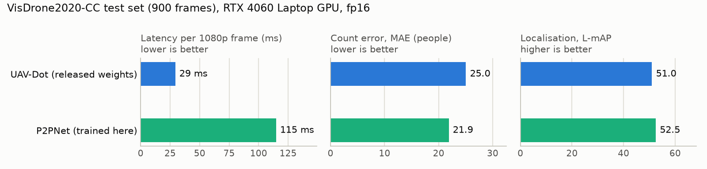
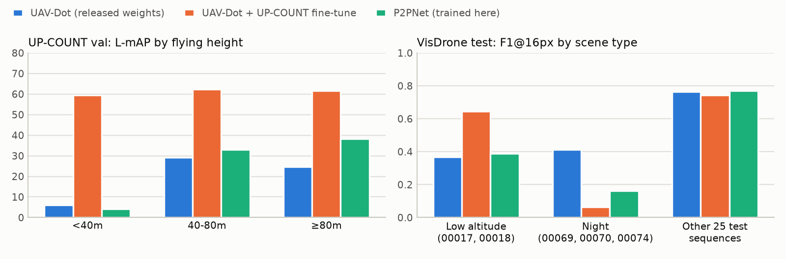
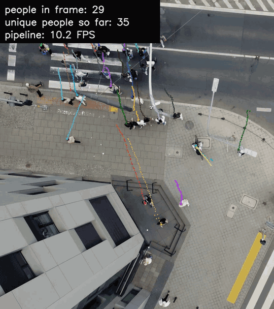

# UAV crowd counting: head points, speed and tracking

[](https://github.com/owaisasghar/uav-p2pnet-head-counting/actions/workflows/tests.yml)


> The banner is a generated conceptual visualization, not an experimental
> result or a frame from VisDrone. Quantitative evidence is reported below.

This project counts people in drone footage by locating every head as an
explicit `(x, y, confidence)` point. It compares two point detectors on
VisDrone2020-CC under the official DroneCrowd localization protocol, makes the
fast one deployable, tests whether more varied training data fixes its blind
spots, and adds multi-person tracking so a video yields trajectories and
unique-person counts, not just per-frame totals.

## What I built

- **P2PNet trained for drone footage.** I adapted the ICCV 2021 model to
  VisDrone2020-CC and fixed an upstream bug that left the localization loss out
  of training. It is the most accurate counter here (test count error 21.9).
- **One evaluation for every model** under the official DroneCrowd protocol. It
  reproduces UAV-Dot's published L-mAP (51.00) exactly.
- **Fast inference.** fp16 weights, channels-last memory and GPU preprocessing
  run UAV-Dot at 29 ms per 1080p frame, 3.9x faster than P2PNet at the same F1.
- **Multi-person tracking.** Feeding the fast detector into uav-dot-track
  matches the authors' tracks on typical scenes with 5x faster detection. It
  cuts the error in unique-person counts from 32% to 10%.
- **An honest domain experiment.** Adding UP-COUNT data fixed low-altitude
  scenes (F1 0.37 to 0.65) but hurt night scenes, so a decision rule set before
  testing kept the original model.

Third-party parts: the UAV-Dot model and weights and the uav-dot-track tracker
(PUT Vision Lab, Apache-2.0), and the P2PNet architecture (Tencent, ICCV 2021).

## Results at a glance

VisDrone2020-CC test set: 900 frames from 30 held-out sequences, 137 people per
frame on average.

| Model | Count MAE ↓ | F1@16 px ↑ | L-mAP ↑ | Latency ↓ | Throughput |
|---|---:|---:|---:|---:|---:|
| P2PNet, trained in this repository | **21.9** | 0.725 | **52.5** | 115 ms | 8.7 FPS |
| UAV-Dot, released weights, fp16 | 25.0 | **0.726** | 51.0 | **29 ms** | **34 FPS** |

<picture>
  <source media="(prefers-color-scheme: dark)" srcset="assets/speed_accuracy_dark.png">
  
</picture>

- **UAV-Dot is 3.9x faster at nearly the same localization quality**; P2PNet
  counts slightly more accurately.
- **Latency** is one 1920×1080 frame on an RTX 4060 Laptop GPU with fp16
  weights, channels-last memory and preprocessing on the GPU. With JPEG decoding
  and upload, end-to-end latency is 42 ms and 128 ms.
- **L-mAP** is the DroneCrowd toolkit's localization mAP, averaged over 1–25 px
  match distances. **F1@16 px** uses one-to-one matching within 16 px.
- **The training data differ.** P2PNet saw 1,950 frames (65 sequences, fold 0
  of a five-fold split). The released UAV-Dot weights were trained on the full
  DroneCrowd training videos.

## What this repository contains

1. **P2PNet adapted to drone footage**: VisDrone2020-CC loading,
   sequence-level splits, a corrected localization loss, resumable training,
   early stopping, a SafeTensors export and a Gradio demo.
2. **One evaluation for both models** under the official DroneCrowd protocol
   ([`evaluate_dronecrowd.py`](scripts/evaluate_dronecrowd.py)), plus a
   reproducible latency benchmark
   ([`benchmark_latency.py`](scripts/benchmark_latency.py)).
3. **A UAV-Dot training pipeline** for VisDrone folds that reproduces the
   upstream recipe ([`train_uavdot.py`](scripts/train_uavdot.py)).
4. **A domain experiment with UP-COUNT**: it fixed UAV-Dot's low-altitude blind
   spot but lost accuracy on the test set. It is reported below as a negative
   result.
5. **Multi-person tracking**: the uav-dot-track tracker on top of the fp16
   detector. On five typical UP-COUNT-TRACK videos it cuts identity switches by
   61% and the error in unique-person counts from 32% to 10%.

## Domain experiment: does more varied data fix UAV-Dot's blind spots?

UAV-Dot misses most people in two low-altitude test sequences (00017, 00018),
where heads are larger than in its training data. UP-COUNT is a 4K drone dataset
filmed at 26–101 m. I fine-tuned UAV-Dot on VisDrone plus UP-COUNT with a wider
zoom augmentation, validating on a VisDrone fold and on UP-COUNT's validation
split. The test set was used once, for the model chosen in advance.

<picture>
  <source media="(prefers-color-scheme: dark)" srcset="assets/upcount_experiment_dark.png">
  
</picture>

| Model | UP-COUNT val L-mAP | below 40 m | Test L-mAP | Test F1, low altitude | Test F1, night |
|---|---:|---:|---:|---:|---:|
| UAV-Dot, released weights | 21.9 | 6.2 | **51.0** | 0.37 | **0.41** |
| UAV-Dot + UP-COUNT fine-tune | 61.6 | 59.5 | 48.4 | **0.65** | 0.06 |
| P2PNet, trained here | 28.2 | 4.1 | 52.5 | 0.39 | 0.16 |
| UP-COUNT specialist, released, 4K input | **77.6** | **76.4** | – | – | – |

- **What worked:** UP-COUNT validation L-mAP rose from 22 to 62, and from 6 to
  60 below 40 m. On the two low-altitude test sequences, F1 rose from 0.37 to
  0.65. On VisDrone fold-0 validation, the same recipe cost only 1.2 L-mAP
  points (65.4 to 64.2).
- **What failed:** test L-mAP fell from 51.0 to 48.4. On the three night
  sequences F1 fell to 0.06, and the model undercounted by 32 people per frame
  instead of 10.
- **Why validation missed it:**
  - Neither validation set contains night footage, and only 3 of the 82
    training sequences do.
  - Darkened daytime frames did not reproduce the failure.
  - The model still finds people in the night frames it trained on (F1 0.86).
- **A gentler retry did not help.** With 20% instead of 50% UP-COUNT and half
  the epochs, test L-mAP was 48.2 (a second test evaluation, reported as such).
  The undercount persisted, so it is not caused mainly by UP-COUNT. My untested
  hypothesis is that the fine-tuning setup itself (batch size 2, a learning-rate
  restart on converged weights) shifts calibration.
- **Decision:** the rule set before testing was to replace the released weights
  only if test L-mAP exceeded 51.0, so the released weights stay the deployed
  detector.

Full numbers and protocol are in [`REPORT.md`](REPORT.md#14-uav-dot-and-the-up-count-domain-experiment).

## Multi-person tracking

<p align="center">
  
</p>

<sub>Full tracker on UP-COUNT-TRACK test video 0086, cropped (video: CC BY-NC 4.0,
PUT Vision Lab). Each trail is one tracked person. The overlay shows people in
the frame and unique people so far, and the tracker ends at 73 unique people,
matching the ground truth. 5 FPS is the full tracker's speed at about 40 people
per frame.</sub>

Per-frame counts cannot tell how many different people crossed a scene.
[`track_video.py`](scripts/track_video.py) feeds the fp16 UAV-Dot detector into
[uav-dot-track](https://github.com/up-count/uav-dot-track) (Ptak & Kraft, IEEE
Access 2026). Its options build on a Kalman-filter tracker:
- **CMC:** camera-motion compensation by optical flow.
- **ALT:** altitude-aware gating.
- **CLS:** a head classifier that vets new tracks.
- **DDCF:** deep discriminative correlation filters, which recover lost people
  from UAV-Dot's decoder features.

The ablation ran on six UP-COUNT-TRACK test videos (4K, 30 FPS, 12–23 s each,
filmed at 30–76 m), scored with TrackEval as in the paper. *Unique-count error*
is the gap between tracked and true identities per video. Speed is detection
plus tracking per frame on the RTX 4060 Laptop GPU and its CPU.

**Five typical videos** (9–38 people per frame):

| Tracker | HOTA | IDF1 | ID switches | Unique-count error | Speed |
|---|---:|---:|---:|---:|---:|
| Kalman baseline | **0.42** | 0.81 | 69 | 11.8 (32%) | **25 FPS** |
| + CMC + ALT + CLS | 0.41 | 0.80 | 89 | 7.0 (24%) | 21 FPS |
| + DDCF (full tracker) | 0.40 | **0.89** | **27** | **3.0 (10%)** | 10.5 FPS |

**Dense video 0016** (1,022 people per frame, 1,182 distinct people):

- **Accuracy:** the full tracker cuts ID switches from 2,028 to 77 and the
  unique-count error from 850 to 240 people (72% to 20%).
- **Cost:** it takes 3.3 s per frame, because DDCF runs one correlation filter
  for every lost person.

The full tracker therefore suits offline analysis of dense crowds, while CMC +
ALT + CLS keeps the real-time path. HOTA barely moves, as in the paper. DDCF
fixes identity continuity, not detection.

**Checked against the authors' own pipeline.** The authors' unmodified
`main.py` (fp32 detector, preprocessing on the CPU) was run on the same six
videos:

- **Typical videos:** identical tracking (full tracker HOTA 0.402 vs 0.401, 26
  vs 27 ID switches), while detection here takes 42 ms per 4K frame instead of
  221 ms.
- **The 1,000-person video:** tiny fp16 numeric differences cascade into
  different identity assignments (full tracker HOTA 0.501 vs 0.513).
  `--precision fp32` reproduces the authors' result (HOTA 0.514, unique-count
  error 189 vs 190) at 79 ms per frame, still 2.8x faster.

## Setup

Linux with an NVIDIA GPU is assumed. The experiments ran on an RTX 4060 Laptop
GPU (8 GB).

**P2PNet environment** (Python 3.13):

```bash
python3 -m venv .venv
.venv/bin/pip install -r requirements.txt        # add -r requirements-dev.txt for tests and charts
```

**UAV-Dot environment** (Python 3.10, [uv](https://docs.astral.sh/uv/)). This
clones [UAV-Dot](https://github.com/up-count/uav-dot) and
[uav-dot-track](https://github.com/up-count/uav-dot-track) into `external/`
at the exact commits used here and installs
[`requirements-uavdot.txt`](requirements-uavdot.txt):

```bash
scripts/setup_uavdot.sh
```

Download the released UAV-Dot checkpoints `dot_pd_dronecrowd_51.00.ckpt` and
`dot_pd_upcount_66.49.ckpt` from the
[UAV-Dot README](https://github.com/up-count/uav-dot#checkpoints) into
`external/uav-dot/checkpoints/`, then verify them:

```bash
sha256sum -c scripts/uavdot_checkpoints.sha256
```

**Data** (not redistributed; obtain each from its authors and follow its terms):

| Dataset | Used for | Location |
|---|---|---|
| VisDrone2020-CC | training, validation, test | `data/raw/VisDrone2020-CC/` |
| UP-COUNT (CC BY-NC 4.0) | domain experiment | `data/raw/UP-COUNT/` |
| UP-COUNT-TRACK (CC BY-NC 4.0) | tracking | `data/raw/UP-COUNT-TRACK/`, via [`download_upcount_track.py`](scripts/download_upcount_track.py) |

The test-set ground truth for VisDrone2020-CC is the DroneCrowd toolkit's,
shipped with UAV-Dot (`external/uav-dot/eval_tool/gt/`). On the validation fold
it matches the VisDrone annotations exactly.

## Reproduce the results

All commands run from the repository root. `UV` below is the UAV-Dot
environment's Python, `external/uav-dot/.venv/bin/python`.

```bash
# Test-set accuracy of both models (official protocol; writes runs/eval/test_metrics.json)
$UV scripts/evaluate_dronecrowd.py --split test \
    uavdot=external/uav-dot/checkpoints/dot_pd_dronecrowd_51.00.ckpt p2pnet=huggingface/model.safetensors

# Latency of both models (writes runs/eval/latency.json)
$UV scripts/benchmark_latency.py \
    uavdot=external/uav-dot/checkpoints/dot_pd_dronecrowd_51.00.ckpt p2pnet=huggingface/model.safetensors

# UAV-Dot on VisDrone fold 0 (upstream recipe), then the UP-COUNT fine-tune from its best checkpoint
$UV scripts/train_uavdot.py --name uavdot_baseline_fold0
$UV scripts/train_uavdot.py --name uavdot_combined_ft_fold0 --epochs 30 --min-epochs 30 \
    --init-checkpoint runs/uavdot_baseline_fold0/checkpoints/<best>.ckpt \
    --upcount-root data/raw/UP-COUNT --zoom-min 0.16
$UV scripts/evaluate_dronecrowd.py --split upcount-val name=runs/uavdot_combined_ft_fold0/checkpoints/last.ckpt

# Tracking ablation on the downloaded UP-COUNT-TRACK test videos, then the authors' pipeline for comparison
.venv/bin/python scripts/download_upcount_track.py --videos 0016 0028 0035 0048 0062 0086
scripts/run_tracking_ablation.sh
$UV scripts/run_upstream_tracker.py data/raw/UP-COUNT-TRACK/test_videos/0035.mp4 baseline
$UV scripts/evaluate_tracking.py baseline full upstream_baseline

# README charts
.venv/bin/python scripts/generate_portfolio_charts.py
```

## P2PNet training and inference

Convert VisDrone2020-CC annotations into per-frame point files and
deterministic train and validation lists:

```bash
PYTHONPATH=. .venv/bin/python scripts/prepare_p2pnet_visdrone.py \
  --root data/raw/VisDrone2020-CC --output data/processed/p2pnet_visdrone --fold 0 --folds 5 --seed 42
```

Fine-tune from the official ShanghaiTech Part A checkpoint
(`third_party/CrowdCounting-P2PNet/weights/SHTechA.pth`, from the
[upstream repository](https://github.com/TencentYoutuResearch/CrowdCounting-P2PNet/tree/main/weights)):

```bash
PYTHONPATH=third_party/CrowdCounting-P2PNet \
  .venv/bin/python third_party/CrowdCounting-P2PNet/train.py \
  --dataset_file VisDrone --data_root data/processed/p2pnet_visdrone \
  --no_pretrained_backbone --resume third_party/CrowdCounting-P2PNet/weights/SHTechA.pth \
  --epochs 100 --lr 0.0001 --lr_backbone 0.00001 --lr_drop 70 --eval_freq 2 --patience 15 \
  --batch_size 2 --patch_size 512 --num_patches 2 --num_workers 4 --seed 42 \
  --output_dir runs/p2pnet_visdrone_fold0/log \
  --checkpoints_dir runs/p2pnet_visdrone_fold0/checkpoints \
  --tensorboard_dir runs/p2pnet_visdrone_fold0/tensorboard --gpu_id 0
```

Training keeps `best_mae.pth` (lowest validation MAE) and `latest.pth` (with
optimizer and scheduler state, for `--resume`). On the fold-0 validation split,
the best epoch (49) reached count MAE 10.03 and F1@16 px 0.815; see
[`REPORT.md`](REPORT.md) for the curves and the threshold sweep.

Export an inference-only SafeTensors model, then run it on an image or a video:

```bash
PYTHONPATH=. .venv/bin/python scripts/export_huggingface_model.py \
  --checkpoint runs/p2pnet_visdrone_fold0/checkpoints/best_mae.pth --output huggingface/model.safetensors
PYTHONPATH=. .venv/bin/python scripts/infer_p2p.py \
  --checkpoint runs/p2pnet_visdrone_fold0/checkpoints/best_mae.pth --input path/to/image.jpg \
  --threshold 0.5 --output-dir inference/p2pnet_external
PYTHONPATH=. .venv/bin/python scripts/infer_p2p_video.py --input path/to/video.mp4 \
  --checkpoint runs/p2pnet_visdrone_fold0/checkpoints/best_mae.pth --output inference/video_p2pnet.mp4 \
  --threshold 0.5 --inference-fps 5 --max-side 1280 --device auto --half
```

- **`huggingface/`:** a ready model-repository package for P2PNet.
- **`huggingface_space/`:** a Gradio demo that runs UAV-Dot and P2PNet side by
  side on an uploaded image. Its standalone UAV-Dot runtime fetches the released
  weights from the authors' mirror and checks their SHA-256, so the weights are
  never re-hosted. It matches the original model on 99.6% of points.

See [`docs/PORTFOLIO_PUBLISHING.md`](docs/PORTFOLIO_PUBLISHING.md). No script
publishes anything automatically.

## Known limitations

- **Single fold.** P2PNet and the UAV-Dot recipe were validated on one sequence
  fold, not a five-fold mean.
- **Little night data.** Only 3 of 82 training sequences are night, and every
  model is weakest there (night test F1 0.06–0.41).
- **Different training sets.** The released UAV-Dot weights saw more training
  frames than P2PNet, so the comparison is between deployable models, not
  architectures.
- **Partial tracking evaluation.** Tracking was scored on a subset of the
  UP-COUNT-TRACK test videos. DroneCrowd's full test videos were not available
  for scripted download.
- **Untested domains.** Performance on other cameras, countries, altitudes or
  weather is unknown. False positives on head-like objects and misses on small
  or occluded heads remain.

## Responsible use

This work was prepared for academic crowd-analysis research. Crowd monitoring
and person tracking can affect privacy and civil rights. Obtain authorization,
comply with local law, minimize retention of identifiable imagery, validate
performance in the actual operating domain, and keep human oversight for
safety-critical use.

## Licenses and attribution

- **Licenses:** this repository is licensed for academic research only,
  following the vendored P2PNet license ([`LICENSE`](LICENSE),
  [`NOTICE.md`](NOTICE.md)). UAV-Dot and uav-dot-track are Apache-2.0 and are
  fetched, not vendored. UP-COUNT and UP-COUNT-TRACK are CC BY-NC 4.0.
- **P2PNet:** Q. Song et al., "Rethinking Counting and Localization in Crowds:
  A Purely Point-Based Framework," ICCV 2021.
- **UAV-Dot and UP-COUNT:** UP-COUNT project, PUT Vision Lab, "Enhancing people
  localisation in drone imagery for better crowd management by utilising every
  pixel in high-resolution images," https://github.com/up-count/uav-dot.
- **Tracking and UP-COUNT-TRACK:** B. Ptak and M. Kraft, "Improving trajectory
  continuity in drone-based crowd monitoring using a set of minimal-cost
  techniques and deep discriminative correlation filters," *IEEE Access*, 2026,
  https://doi.org/10.1109/ACCESS.2026.3674587.
- **DroneCrowd:** L. Wen et al., "Detection, Tracking, and Counting Meets Drones
  in Crowds: A Benchmark," CVPR 2021.
- **Related UAV study:** B. Ptak, D. Pieczyński, M. Piechocki and M. Kraft,
  "On-Board Crowd Counting and Density Estimation Using Low Altitude Unmanned
  Aerial Vehicles—Looking beyond Beating the Benchmark," *Remote Sensing*,
  2022, https://doi.org/10.3390/rs14102288.

Machine-readable citation metadata is in [`CITATION.cff`](CITATION.cff).
