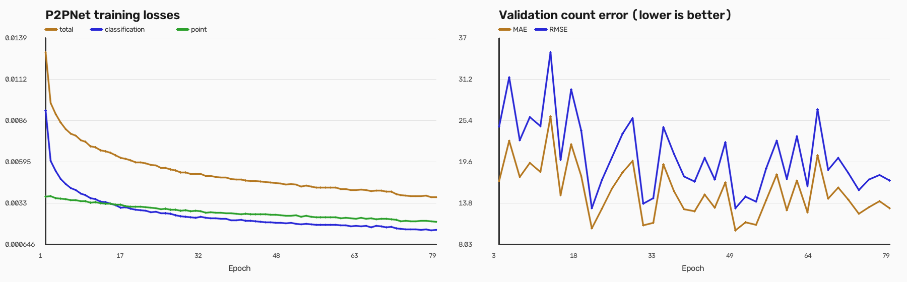
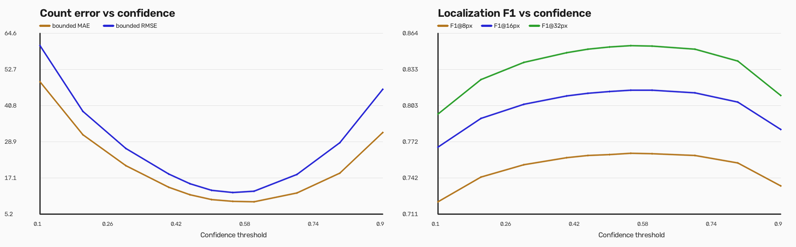

# UAV P2PNet head detection and crowd counting

[](https://github.com/owaisasghar/uav-p2pnet-head-counting/actions/workflows/tests.yml)


> The banner is a generated conceptual visualization, not an experimental
> result or a frame from VisDrone. Quantitative evidence is reported below.

This research repository adapts
[P2PNet](https://github.com/TencentYoutuResearch/CrowdCounting-P2PNet) for
individual head-point localization and crowd counting in VisDrone2020-CC
aerial imagery. Unlike density-map visualization, every retained prediction is
an explicit `(x, y, confidence)` head proposal.

The repository contains the VisDrone data adapter, sequence-level split
preparation, corrected P2PNet training code, checkpoint management, early
stopping, metrics logging, and full-resolution point inference. The trained
checkpoint is not tracked in Git; it can be distributed as a release asset or
as an inference-only SafeTensors model after the license review described
below.

> **License restriction:** the vendored P2PNet source is licensed for academic
> research only. Read
> [`LICENSE`](LICENSE) and
> [`third_party/CrowdCounting-P2PNet/LICENSE`](third_party/CrowdCounting-P2PNet/LICENSE)
> before using or redistributing this project.

## Result summary

| Item | Result |
|---|---:|
| Dataset | VisDrone2020-CC |
| Split | Sequence-level fold 0 of 5, seed 42 |
| Training frames | 1,950 |
| Validation frames | 510 |
| Training head points | 290,556 |
| Validation head points | 72,171 |
| Best epoch | 49 |
| Best validation MAE | **10.0255** |
| Best validation RMSE | **13.0832** |
| Localization precision @ 16 px | **0.7988** |
| Localization recall @ 16 px | **0.8315** |
| Localization F1 @ 16 px | **0.8148** |
| Ranked localization AP @ 16 px | **0.8558** |
| Confidence threshold | 0.5 |
| Stopping epoch | 79 of 100, early stopping |

The counting values reproduce the original training-log protocol. Removing
predictions outside the source-image boundary gives MAE 10.0235 and RMSE
13.0795. Localization uses one-to-one Hungarian matching on the same 510-image
validation fold. A prediction is correct at `F1@16px` when it lies within 16
pixels of an unmatched annotated head.

Lower MAE/RMSE and higher localization scores are better. None of these values
is a classification-accuracy percentage. Ranked AP uses proposals with scores
above 0.001 and the same fixed pixel-radius matching definition; it is not the
head-size-normalized nAP protocol used by datasets that provide head boxes.





Detailed methodology and limitations are documented in [`REPORT.md`](REPORT.md).
Checkpoint-specific details are in [`MODEL_CARD.md`](MODEL_CARD.md).

## Relationship to the UAV paper

This repository is a **P2PNet adaptation and extension**, not a reproduction of
the network from Ptak et al., *Remote Sensing* 2022. The referenced UAV paper
uses density regression, optical-flow channels, multiple architectures and
input resolutions, embedded-device evaluation, and five-fold validation. This
project instead performs direct individual head-point prediction with P2PNet.

The projects share the VisDrone2020-CC domain and the concern that larger
models can overfit a relatively small aerial benchmark. A direct paper
reproduction would still require the paper's density models, optical-flow
pipeline, five folds, input-resolution study, and embedded-hardware benchmark.

## Repository layout

```text
.
├── .github/workflows/tests.yml
├── CITATION.cff
├── LICENSE
├── MODEL_CARD.md
├── REPORT.md
├── RELEASE_NOTES.md
├── assets/
│   ├── threshold_sweep.png
│   ├── training_curves.png
│   └── uav_p2pnet_social_preview.jpg
├── docs/
│   ├── GITHUB_PROFILE_README.md
│   └── PORTFOLIO_PUBLISHING.md
├── huggingface/
│   ├── README.md
│   ├── inference.py
│   ├── p2pnet_runtime.py
│   └── config.json
├── huggingface_space/
│   ├── README.md
│   └── app.py
├── reports/
│   └── fold0_localization.json
├── requirements-ci.txt
├── requirements-dev.txt
├── requirements.txt
├── scripts/
│   ├── aggregate_fold_results.py
│   ├── evaluate_p2p_localization.py
│   ├── generate_report_assets.py
│   ├── infer_p2p.py
│   ├── infer_p2p_video.py
│   ├── p2p_metrics.py
│   ├── p2p_visdrone_utils.py
│   ├── prepare_p2pnet_visdrone.py
│   └── export_huggingface_model.py
├── tests/
│   └── test_p2p_metrics.py
└── third_party/CrowdCounting-P2PNet/
    ├── crowd_datasets/VisDrone/
    ├── models/
    ├── util/
    ├── LICENSE
    └── train.py
```

The dataset, checkpoints, training logs, TensorBoard events, and generated
inference images are deliberately ignored. This keeps the Git repository small
and avoids redistributing VisDrone imagery.

## Requirements

- Linux
- Python 3.13 for the reproduced environment
- NVIDIA CUDA-capable GPU recommended
- GitHub CLI when downloading a published model release
- Sufficient RAM/VRAM for full-resolution inference

The completed experiment used an NVIDIA GeForce RTX 4060 Laptop GPU with 8 GB
VRAM. CPU inference works but is much slower.

## Clone and install

The repository is currently private, so authorized users must authenticate the
GitHub CLI first:

```bash
gh auth login
gh repo clone owaisasghar/uav-p2pnet-head-counting
cd uav-p2pnet-head-counting
python3 -m venv .venv
.venv/bin/python -m pip install --upgrade pip
.venv/bin/pip install -r requirements.txt
```

Install the additional test dependency when modifying the evaluation code:

```bash
.venv/bin/pip install -r requirements-dev.txt
```

Run the synthetic matching and metric tests with:

```bash
PYTHONPATH=. .venv/bin/python -m pytest -q
```

## Download the trained model

The `v1.0.0` release is currently a draft. After it is reviewed and published,
authorized users can download the best checkpoint with:

```bash
mkdir -p runs/p2pnet_visdrone_fold0/checkpoints
gh release download v1.0.0 \
  --repo owaisasghar/uav-p2pnet-head-counting \
  --pattern best_mae.pth \
  --dir runs/p2pnet_visdrone_fold0/checkpoints
sha256sum runs/p2pnet_visdrone_fold0/checkpoints/best_mae.pth
```

Expected SHA-256:

```text
8add58d38e1e0bb2d0de96500073eda9171d1af796488b5faf6e7b218df53233
```

External users cannot download a draft release. Publishing remains a manual
step and must happen only after the evaluated source and license are reviewed.

## Prepare VisDrone2020-CC

Obtain VisDrone2020-CC from its authorized distributor. Do not commit the
archive or extracted images. The expected source layout is:

```text
data/raw/VisDrone2020-CC/
├── annotations/
│   ├── 00001.txt
│   └── ...
└── sequences/
    ├── 00001/
    │   ├── 00001.jpg
    │   └── ...
    └── ...
```

Convert sequence annotations into per-frame point files and deterministic
train/validation lists:

```bash
PYTHONPATH=. .venv/bin/python scripts/prepare_p2pnet_visdrone.py \
  --root data/raw/VisDrone2020-CC \
  --output data/processed/p2pnet_visdrone \
  --fold 0 \
  --folds 5 \
  --seed 42
```

Expected summary:

```json
{
  "train_frames": 1950,
  "validation_frames": 510,
  "train_points": 290556,
  "validation_points": 72171
}
```

## Train

To reproduce the initialization used for this run, place the official
ShanghaiTech Part A P2PNet checkpoint at:

```text
third_party/CrowdCounting-P2PNet/weights/SHTechA.pth
```

It can be downloaded directly from the upstream repository:

```bash
mkdir -p third_party/CrowdCounting-P2PNet/weights
curl -L \
  https://github.com/TencentYoutuResearch/CrowdCounting-P2PNet/raw/main/weights/SHTechA.pth \
  -o third_party/CrowdCounting-P2PNet/weights/SHTechA.pth
```

Then run:

```bash
PYTHONPATH=third_party/CrowdCounting-P2PNet \
  .venv/bin/python third_party/CrowdCounting-P2PNet/train.py \
  --dataset_file VisDrone \
  --data_root data/processed/p2pnet_visdrone \
  --no_pretrained_backbone \
  --resume third_party/CrowdCounting-P2PNet/weights/SHTechA.pth \
  --epochs 100 \
  --lr 0.0001 \
  --lr_backbone 0.00001 \
  --lr_drop 70 \
  --eval_freq 2 \
  --patience 15 \
  --batch_size 2 \
  --patch_size 512 \
  --num_patches 2 \
  --num_workers 4 \
  --seed 42 \
  --output_dir runs/p2pnet_visdrone_fold0/log \
  --checkpoints_dir runs/p2pnet_visdrone_fold0/checkpoints \
  --tensorboard_dir runs/p2pnet_visdrone_fold0/tensorboard \
  --gpu_id 0
```

Training writes:

- `best_mae.pth`: checkpoint with the lowest validation MAE;
- `latest.pth`: most recent checkpoint including optimizer and scheduler state;
- `metrics.jsonl`: per-epoch loss, learning rate, MAE, and RMSE;
- TensorBoard events under the configured TensorBoard directory.

Resume an interrupted training run by changing `--resume` to `latest.pth`. The
saved epoch, optimizer, and scheduler are restored automatically.

## Inference

Run on a deterministic held-out frame:

```bash
PYTHONPATH=. .venv/bin/python scripts/infer_p2p.py \
  --checkpoint runs/p2pnet_visdrone_fold0/checkpoints/best_mae.pth \
  --validation-index 122 \
  --threshold 0.5 \
  --output-dir inference/p2pnet_visdrone_best
```

Run on an external aerial image:

```bash
PYTHONPATH=. .venv/bin/python scripts/infer_p2p.py \
  --checkpoint runs/p2pnet_visdrone_fold0/checkpoints/best_mae.pth \
  --input path/to/image.jpg \
  --threshold 0.5 \
  --output-dir inference/p2pnet_external
```

Each inference run writes:

- `*_predicted_points.jpg`: red predicted head points;
- `*_comparison.jpg`: prediction and green ground truth side by side when an
  annotation exists;
- `*_points.json`: count, latency, device, and every predicted
  `(x, y, confidence)` tuple.

The script pads the image to a multiple of 128 without rescaling the original
coordinates. Predictions outside the original image boundary are removed.

Run scheduled inference on a video while preserving its output frame rate:

```bash
PYTHONPATH=. .venv/bin/python scripts/infer_p2p_video.py \
  --input path/to/video.mp4 \
  --checkpoint runs/p2pnet_visdrone_fold0/checkpoints/best_mae.pth \
  --output inference/video_p2pnet.mp4 \
  --threshold 0.5 \
  --inference-fps 5 \
  --max-side 1280 \
  --device auto \
  --half
```

`--inference-fps` controls how often a fresh prediction is produced; the most
recent points are drawn on intervening frames. This is scheduled inference,
not fresh detection on every output frame.

## Hugging Face model and interactive demo

Export only the model tensors from the full training checkpoint to the safer,
inference-only SafeTensors format:

```bash
PYTHONPATH=. .venv/bin/python scripts/export_huggingface_model.py \
  --checkpoint runs/p2pnet_visdrone_fold0/checkpoints/best_mae.pth \
  --output huggingface/model.safetensors
```

Run the standalone exported model locally:

```bash
cd huggingface
../.venv/bin/python inference.py \
  --weights model.safetensors \
  --input path/to/aerial_image.jpg \
  --output prediction.png \
  --json-output prediction.json \
  --threshold 0.5 \
  --device auto
```

The `huggingface/` directory is a ready model-repository package with YAML
metadata, custom license, runtime, configuration, and model card. The separate
`huggingface_space/` directory contains a Gradio image-upload demo. See
[`docs/PORTFOLIO_PUBLISHING.md`](docs/PORTFOLIO_PUBLISHING.md) for the manual
publishing checklist; no publishing is performed by these scripts.

## Count and localization evaluation

Reproduce count metrics, sweep confidence thresholds, and compute point
precision/recall/F1 at 8, 16, and 32 pixel radii:

```bash
PYTHONPATH=. .venv/bin/python scripts/evaluate_p2p_localization.py \
  --checkpoint runs/p2pnet_visdrone_fold0/checkpoints/best_mae.pth \
  --data-root data/processed/p2pnet_visdrone \
  --output reports/fold0_localization.json \
  --device cuda \
  --thresholds 0.1 0.2 0.3 0.4 0.45 0.5 0.55 0.6 0.7 0.8 0.9 \
  --radii 8 16 32
```

At the fixed 0.50 threshold, the deployment-style metrics are:

| Radius | Precision | Recall | F1 | Ranked AP |
|---:|---:|---:|---:|---:|
| 8 px | 0.7468 | 0.7773 | 0.7617 | 0.7729 |
| 16 px | **0.7988** | **0.8315** | **0.8148** | **0.8558** |
| 32 px | 0.8356 | 0.8698 | 0.8523 | 0.8943 |

The validation-tuned count threshold is 0.60 (MAE 9.2902); the tuned F1
threshold is 0.55 (F1@16px 0.8160). These are calibration results from the same
fold used for checkpoint selection, so they are not independent-test metrics.

Generate the plots after evaluation:

```bash
PYTHONPATH=. .venv/bin/python scripts/generate_report_assets.py
```

After training all five folds, aggregate a fixed protocol without choosing a
different threshold per fold:

```bash
PYTHONPATH=. .venv/bin/python scripts/aggregate_fold_results.py \
  reports/fold0_localization.json \
  reports/fold1_localization.json \
  reports/fold2_localization.json \
  reports/fold3_localization.json \
  reports/fold4_localization.json \
  --threshold 0.5 \
  --radius 16 \
  --output reports/five_fold_summary.json
```

## Important implementation changes

This repository vendors upstream P2PNet commit
`5c91a81ca062b1c7fd3db3ad1c55b1c21f0a7455` and adds:

- VisDrone2020-CC sequence parsing and a deterministic five-fold split;
- crowd-aware 512×512 training crops, scaling, color jitter, and flipping;
- configurable pretrained-backbone loading;
- portable VGG weight loading;
- checkpoint resume with optimizer, scheduler, and epoch state;
- JSONL metrics, best-checkpoint selection, and early stopping;
- modern PyTorch/torchvision compatibility;
- direct point-inference images and JSON output;
- image-boundary-aware count and localization evaluation;
- confidence-threshold sweeps and portfolio plots;
- an inference-only SafeTensors export and standalone Hugging Face runtime;
- a Gradio image demo that returns both an annotated image and point JSON;
- CI tests, citation metadata, and an explicit academic-only root license;
- device-correct anchor generation for explicit CPU or GPU inference;
- a correction from `loss_points` to `loss_point`, ensuring the localization
  loss returned by the criterion is actually included in optimization.

## Known limitations

- Only one deterministic sequence-level fold was trained; the result is not a
  five-fold mean.
- Pixel-radius precision, recall, F1, and AP are reported, but VisDrone2020-CC
  does not provide head boxes needed for a head-size-normalized nAP protocol.
- Threshold calibration reused the checkpoint-selection validation fold; an
  independent test set is still required.
- Performance has not been established on a different drone, camera, country,
  altitude distribution, or weather domain.
- Full-resolution VGG16-BN P2PNet inference is not real-time on the reproduced
  laptop GPU without further optimization.
- The model may produce false positives on objects that visually resemble
  people and may miss small, occluded, or low-contrast heads.

## Responsible use

This model was prepared for academic crowd-analysis research. Crowd monitoring
can affect privacy and civil rights. Obtain authorization, comply with local
law, minimize retention of identifiable imagery, validate performance for the
actual operating domain, and keep human oversight for safety-critical use.

## Attribution

The implementation is based on:

> Qingyu Song, Changan Wang, Zhengkai Jiang, Yabiao Wang, Ying Tai,
> Chengjie Wang, Jilin Li, Feiyue Huang, and Yang Wu,
> “Rethinking Counting and Localization in Crowds: A Purely Point-Based
> Framework,” ICCV 2021.

See the upstream license and [`NOTICE.md`](NOTICE.md) for source provenance and
modification details. Machine-readable software citation metadata is available
in [`CITATION.cff`](CITATION.cff).

The UAV deployment comparison discussed above refers to:

> Bartosz Ptak, Dominik Pieczyński, Mateusz Piechocki, and Marek Kraft,
> “On-Board Crowd Counting and Density Estimation Using Low Altitude Unmanned
> Aerial Vehicles—Looking beyond Beating the Benchmark,” *Remote Sensing*,
> 2022, https://doi.org/10.3390/rs14102288.
